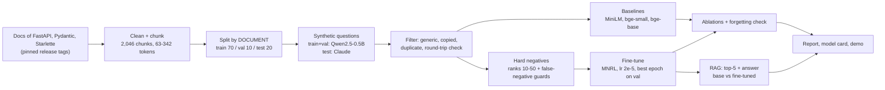
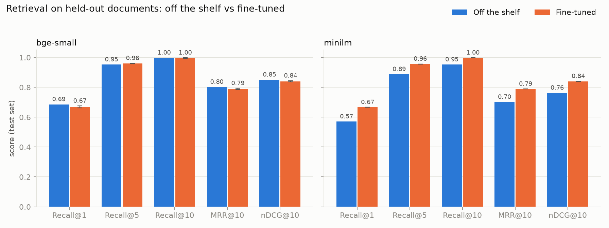
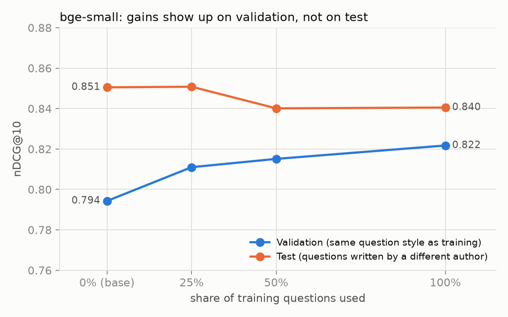

# Fine-Tuning Embedding Models for Domain Retrieval

Fine-tune small open-source embedding models on **synthetic question-passage pairs** from a domain corpus (the documentation of
**FastAPI, Pydantic and Starlette**), measure the gain on **held-out documents**, ablate every design choice, and check whether
better retrieval improves a RAG system end to end.

> **Headline result, stated honestly:** fine-tuning helped a weak base model a lot and a strong one not at all.
> **all-MiniLM-L6-v2: nDCG@10 0.763 → 0.841 (+7.8 points, 95% CI [+5.2, +10.3]).**
> **bge-small-en-v1.5: 0.851 → 0.840 (−1.0 points, CI [−2.8, +0.8], not significant)**, even though it improved on validation
> questions written like its training data. Hard negatives and more data barely mattered, there was no detectable forgetting,
> and the RAG answers did not get better. Section [What the results mean](#what-the-results-mean) explains why.

## Contents
[Problem](#problem) · [Architecture](#architecture) · [Data](#data) · [Results](#results) · [What the results mean](#what-the-results-mean) ·
[Limitations and deviations](#limitations-and-deviations-from-the-brief) · [Reproduce](#reproduce) · [Repo layout](#repo-layout) ·
[Hugging Face and demo](#hugging-face-and-demo)

## Problem

Off-the-shelf embedding models are trained on general text. Developer documentation has its own vocabulary (*path operation*,
*dependency*, *discriminated union*, *lifespan*). The question this project answers with measurements rather than hope:
**does fine-tuning on LLM-generated questions make retrieval over a specific documentation set better, by how much, and when?**

## Architecture



Full diagram with leakage rules, module map and hardware notes: [docs/architecture.md](docs/architecture.md).
Every phase is one script under `scripts/`; each reads files and writes files, so any phase can be re-run alone.

## Data

| Split | Docs | Chunks | Questions kept | Question writer |
|---|---|---|---|---|
| train | 111 | 1,449 | 3,352 | Qwen2.5-0.5B-Instruct |
| val | 24 | 172 | 414 | Qwen2.5-0.5B-Instruct |
| test | 37 | 425 | 461 (of 510) | **Claude** (a different author on purpose) |

* Chunks are structure-aware (never cut mid-paragraph or mid-code-block), 63-342 tokens (median 247), with a heading breadcrumb.
  Splitting is **by document, before any question exists**; 0 documents span two splits and 0 chunk bodies repeat across splits.
  Pages with more than 40 chunks always go to train, so no single page dominates the test set.
* **Filtering** raw Qwen questions (4,868 → 3,766): copies a ≥6-word run from the chunk (136), too generic / too short / refers to "the passage" (28), duplicates
  (257), and failing the **round-trip check** — the base model must retrieve the source chunk in its top 20 (681).
* **Hard negatives** (train chunks only): one chunk from the base model's ranks 10-50 per question. Candidates are dropped if they
  are neighbours of the positive in the same document, near-copies of it (cosine > 0.90), or if a cross-encoder scores them close to the
  positive. For bge-small this removed 1,553 neighbours, 2,199 near-copies and **2,312 likely false negatives**; 19 of 3,352
  questions had no safe candidate and got a random negative from another document.

## Results

All numbers are on the **test split, held-out corpus** (only the 425 unseen test chunks are indexed), 461 filtered questions.
Fine-tuned bge-small rows are mean ± std over 3 seeds; every other fine-tuned row is a single run (see
[limitations](#limitations-and-deviations-from-the-brief)).

### 1. Baselines — the numbers to beat

| model | Recall@1 | Recall@5 | Recall@10 | MRR@10 | nDCG@10 |
|---|---|---|---|---|---|
| all-MiniLM-L6-v2 | 0.571 | 0.887 | 0.952 | 0.702 | 0.763 |
| bge-small-en-v1.5 | 0.685 | 0.952 | 0.998 | 0.802 | 0.851 |
| bge-base-en-v1.5 (larger) | 0.662 | 0.952 | 0.991 | 0.788 | 0.839 |

The strongest baseline already has Recall@10 = 0.998, so the only headroom is in Recall@1 / MRR. The larger model is not better here.

### 2. (a)+(d) Base vs fine-tuned, two base models



| model | Recall@1 | Recall@5 | Recall@10 | MRR@10 | nDCG@10 |
|---|---|---|---|---|---|
| minilm (off the shelf) | 0.571 | 0.887 | 0.952 | 0.702 | 0.763 |
| **minilm fine-tuned** (1 run) | **0.666** | **0.957** | **0.998** | **0.789** | **0.841** |
| Δ | +0.095 | +0.069 | +0.045 | +0.087 | **+0.078** |
| bge-small (off the shelf) | 0.685 | 0.952 | 0.998 | 0.802 | 0.851 |
| bge-small fine-tuned (3 seeds) | 0.669 ± 0.006 | 0.960 ± 0.001 | 0.996 ± 0.002 | 0.790 ± 0.004 | 0.840 ± 0.003 |
| Δ | −0.017 | +0.007 | −0.002 | −0.013 | **−0.010** |

Paired bootstrap over the 461 test queries (seed-averaged for bge-small):

| model | mean Δ nDCG@10 | 95% CI | queries better / worse |
|---|---|---|---|
| minilm | **+0.078** | [+0.052, +0.103] | 149 / 63 |
| bge-small | −0.010 | [−0.028, +0.008] | 75 / 86 |

### 3. (b) Hard negatives, on vs off

| model | training | seeds | Recall@1 | MRR@10 | nDCG@10 |
|---|---|---|---|---|---|
| bge-small | in-batch negatives only | 1 | 0.664 | 0.787 | 0.839 |
| bge-small | + mined hard negatives | 3 | 0.669 ± 0.006 | 0.790 ± 0.004 | 0.840 ± 0.003 |
| minilm | in-batch negatives only | 1 | 0.653 | 0.784 | 0.837 |
| minilm | + mined hard negatives | 1 | 0.666 | 0.789 | 0.841 |

Hard negatives gave at most +1.3 points of Recall@1 and +0.4 of nDCG@10, inside what one seed can move. **No evidence they matter here.**

### 4. (c) Training-data size (bge-small, with hard negatives)



| train fraction | train examples | seeds | val nDCG@10 | test nDCG@10 | test Recall@1 |
|---|---|---|---|---|---|
| 0% (off the shelf) | 0 | - | 0.794 | 0.851 | 0.685 |
| 25% | 838 | 1 | 0.811 | 0.851 | 0.690 |
| 50% | 1,676 | 1 | 0.815 | 0.840 | 0.666 |
| 100% | 3,352 | 3 | 0.822 | 0.840 | 0.669 |

Validation rises steadily with data (+1.7 → +2.1 → +2.8 points). Test does not.

### 5. Why: the question *writer* matters (diagnostic)

Test chunks are unseen documents in every row; only the question author differs. "Qwen-written" are 1,049 questions generated for the
test chunks by the same model that wrote the training questions (same filters).

| model | questions | n | base nDCG@10 | fine-tuned nDCG@10 | Δ | 95% CI |
|---|---|---|---|---|---|---|
| bge-small | Claude-written | 461 | 0.850 | 0.841 | −0.010 | [−0.028, +0.009] |
| bge-small | Qwen-written | 1,049 | 0.737 | 0.777 | **+0.040** | [+0.027, +0.053] |
| minilm | Claude-written | 461 | 0.763 | 0.840 | **+0.078** | [+0.053, +0.103] |
| minilm | Qwen-written | 1,049 | 0.626 | 0.774 | **+0.148** | [+0.130, +0.166] |

### 6. Robustness: other evaluation settings

| model | setting | base nDCG@10 | fine-tuned nDCG@10 |
|---|---|---|---|
| bge-small | held-out corpus, filtered questions (primary) | 0.851 | 0.840 ± 0.003 |
| bge-small | **all 2,046 chunks indexed** | 0.795 | 0.790 ± 0.003 |
| bge-small | held-out corpus, **unfiltered** questions (485) | 0.817 | 0.819 ± 0.003 |
| minilm | held-out corpus, filtered questions (primary) | 0.763 | 0.841 |
| minilm | all 2,046 chunks indexed | 0.682 | 0.785 |
| minilm | held-out corpus, unfiltered questions | 0.737 | 0.818 |

The conclusions do not depend on the round-trip filter or on the index size.

### 7. (e) Forgetting check (general-domain BEIR subsets, 300 queries each)

| model | dataset | off the shelf nDCG@10 | fine-tuned nDCG@10 | Δ |
|---|---|---|---|---|
| bge-small | SciFact | 0.709 | 0.704 | −0.004 |
| bge-small | NFCorpus | 0.336 | 0.337 | +0.001 |
| minilm | SciFact | 0.648 | 0.644 | −0.004 |
| minilm | NFCorpus | 0.306 | 0.301 | −0.005 |

No detectable forgetting: all changes are under half a point, far below the ~±3 point noise of 300 queries. (Relevance is binary, so
nDCG differs slightly from the official graded BEIR number. MS MARCO was not used; SciFact and NFCorpus are small BEIR sets that fit the hardware.)

### 8. RAG end to end (50 test questions)

Same pipeline for both systems: embed all 2,046 chunks, retrieve top-5, answer with `Qwen2.5-0.5B-Instruct` (greedy, same prompt).
Only the embedder differs (bge-small off the shelf vs its fine-tuned version chosen by validation score).
**Scoring: 100 answers scored blind by Claude** against hand-written reference answers (the X/Y labels were not unblinded until all 50
were scored; scores in [`data/rag/score_blind.py`](data/rag/score_blind.py)). Rubric, fixed in advance: *correctness* 0-2 (2 = all key
facts of the reference, 1 = partly right, 0 = wrong or no answer); *hallucination* 0/1 (invented API, wrong code, claims that contradict the reference).

| system | correctness (0-2) | hallucination rate | gold passage in top-5 | refused |
|---|---|---|---|---|
| base embedder | 0.98 | 0.32 | 44/50 | 2/50 |
| fine-tuned embedder | 0.94 | 0.42 | 45/50 | 1/50 |

Per question the fine-tuned system was better on 9, worse on 12, tied on 29 (paired bootstrap p = 0.66): **no measurable difference**,
as expected when retrieval itself did not improve. The tiny generator is the real bottleneck: it hallucinates in a third of its
answers and **never produced the requested inline `[n]` citations** (0/100), so citation quality could not be evaluated.
The pipeline still returns the retrieved passage ids, so sources can be shown next to an answer.

## What the results mean

1. **Fine-tuning helps when there is room to improve.** MiniLM (nDCG 0.76) gained 8 points and now sits within 1 point of the
   stronger off-the-shelf bge-small. bge-small (0.85, Recall@10 = 0.998) had almost nothing left to gain.
2. **Part of the gain is style, not domain knowledge.** Both models gain more on questions written like their training data
   (+14.8 vs +7.8 for MiniLM; +4.0 vs −1.0 for bge-small). Roughly 5-7 points of the apparent improvement came from learning the
   *generator's phrasing*. A validation set built the same way as the training data would have hidden this; the differently-authored
   test set exposed it. Claude's questions name the exact function or parameter, so they are easier for a base model than Qwen's vaguer ones.
3. **The synthetic data is a ceiling.** The round-trip filter keeps only questions the base model already answers somewhere in its top 20,
   so training signal is mostly "already easy" examples. That fits why hard negatives and 4× more data changed so little.
4. **A weak finding is still a finding.** For a strong base model, ~3,000 synthetic questions are not worth fine-tuning on; spending the
   effort on better questions (human-written, harder, more varied) or on picking a stronger base model would pay off more.

## Limitations and deviations from the brief

* **Hardware shaped the choices.** Built on a GTX 1650 (4 GB). Measured there: fp16 matmul 0.17 TFLOPS, bf16 0.8, fp32 1.4 — so everything
  runs in **fp32** and the question/answer LLM is the **0.5B** model (the largest that fits in fp32). Training uses
  `CachedMultipleNegativesRankingLoss` (gradient caching, mini-batch 8): the same loss over the full batch of 32, but it fits in memory.
* **No LLM API was available**, so train/val questions come from a local 0.5B model (noisy: 23% were dropped by filters). The **test questions
  were written by Claude** (Sonnet 5.5) while reading each test chunk. Different authors for train and test is deliberate (it is what exposed the
  style effect), but it means test questions are higher quality than training ones and **not real user questions**. Treat all absolute
  numbers as "on synthetic questions".
* **Seeds:** 3 seeds only for the bge-small main comparison; every other cell is one run to fit the compute budget. The hard-negative,
  data-size and MiniLM comparisons therefore have no error bars and differences under ~1 point should not be read as real.
* **Small test set:** 461 questions from 37 documents; the 95% CI half-width on nDCG@10 is about ±2 points.
* **Round-trip filter bias:** it removes questions the base model cannot retrieve, which favours the base model on the test set; section 6 shows
  results do not change on unfiltered questions.
* **Judging:** the RAG answers were scored by one judge (Claude), blind to the system but not independent of the author of the test set; the
  reference answers were also written by Claude. A second judge or human spot-check would strengthen it.
* **Not done:** pushing to the Hugging Face Hub (needs your write token; one command below), MS MARCO for the forgetting check.
* **Duplicates:** only exact chunk duplicates are removed; near-duplicate code examples can cross splits.
* Corpus: docs of three specific releases; the chunks and questions in `data/` are derived from open-source documentation (MIT/BSD licensed).

## Reproduce

```bash
py -3.11 -m venv .venv && .venv\Scripts\activate         # Python 3.11
pip install torch==2.5.1 --index-url https://download.pytorch.org/whl/cu121   # or the CPU build
pip install -r requirements.txt

python scripts/01_build_corpus.py          # ~1 min    docs -> chunks -> document split
python scripts/02_generate_questions.py    # ~55 min   Qwen questions for train/val (GPU; batch 4 is fastest on 4 GB)
python scripts/02b_import_test_questions.py  #         Claude-written test questions (data/synthetic/test_questions_claude.tsv)
python scripts/02c_filter_questions.py     # ~3 min    filters + round-trip check
python scripts/03_baselines.py             # ~15 min   MiniLM / bge-small / bge-base
python scripts/04_mine_negatives.py --model bge-small   # ~8 min each; also --model minilm
python scripts/06_ablations.py             # ~3 h      8 training runs (calls scripts/05_train.py)
bash scripts/post_training.sh              # ~1 h      style-shift check, forgetting, RAG run, report
python data/rag/score_blind.py && python scripts/07c_score_rag.py   # RAG scores (manual scores are included)
python scripts/06c_make_report.py          # tables + figures
```

Every setting lives in [`configs/config.yaml`](configs/config.yaml) (seed 42 everywhere; training seeds 42/43/44). All intermediate
files that define the results are committed (`data/processed`, `data/synthetic`, `data/triplets`, `data/rag`, `results/`), so the
tables can be regenerated without re-running generation or training. `scripts/watch_progress.ps1` shows a live view of long runs.

## Repo layout

```
configs/config.yaml     all settings          docs/architecture.md   diagrams, leakage rules, hardware notes
src/                    library code          docs/interview_questions.md   questions to learn from
scripts/                one script per phase  data/                  chunks, questions, triplets, RAG sheet (small files tracked)
app/demo.py             Gradio side-by-side   results/               CSV logs, tables/, figures/, per_query/
MODEL_CARD.md           Hub model card
```

## Hugging Face and demo

The published model is the **MiniLM fine-tune** (the one with a robust gain); the card says plainly that bge-small off the shelf is still slightly stronger.

```bash
# the model folder is models/minilm_hn_100_s42/final (weights are not in git); the card is already generated
set HF_TOKEN=hf_xxx            # a *write* token from https://huggingface.co/settings/tokens
python scripts/08_package.py push --model minilm --repo-id YOUR_USERNAME/minilm-fastapi-docs

python app/demo.py --base minilm --ft-model models/minilm_hn_100_s42/final    # side-by-side retrieval demo
```
