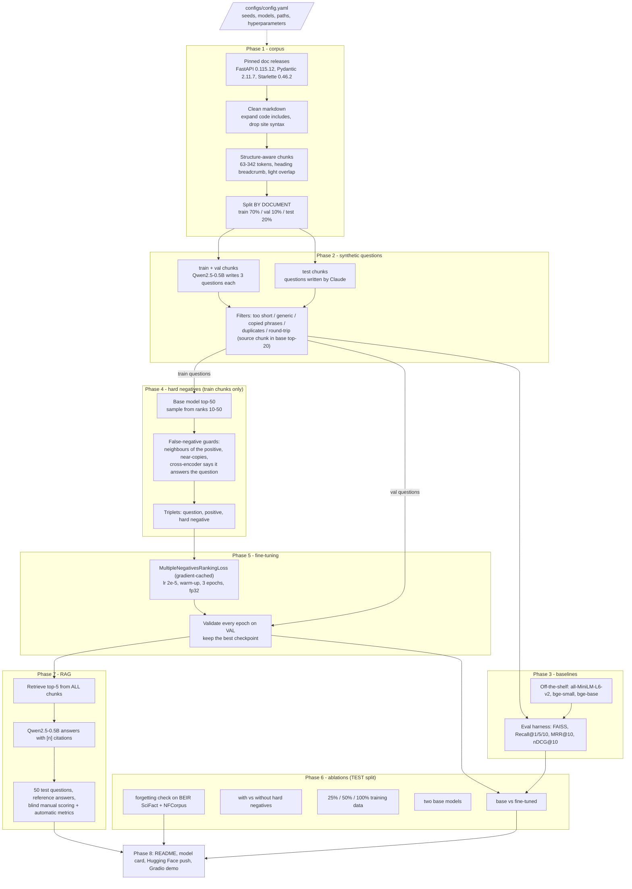

# Architecture

This project has two halves: an **offline pipeline** that builds a better embedding model, and an **evaluation layer** that
proves (or disproves) that it is better, first for retrieval and then inside a RAG system.

## End-to-end pipeline

## Data flow and the leakage rules

| Rule | Where it is enforced |
|---|---|
| Split by **document** before any question exists | `scripts/01_build_corpus.py` writes `doc_splits.json`; Phase 2 asserts every question's split matches its chunk's split |
| No duplicate chunk text across splits | `src/splits.py: check_leakage` fails the build if one appears |
| Hard negatives come from **train chunks only** | `scripts/04_mine_negatives.py` builds its index from `split == "train"` |
| Training data contains train chunks only | `scripts/05_train.py` asserts it before training |
| Validation picks the checkpoint, test is read once per finished run | `scripts/05_train.py` |
| The published model is chosen by **validation** score, not test | `scripts/08_package.py: best_run` |
| Train and test questions have different authors | train/val: Qwen2.5-0.5B-Instruct, test: Claude |

## Module map

| Path | Responsibility |
|---|---|
| `configs/config.yaml` | every setting: sources, chunking, split ratios, models, filters, mining, training, RAG |
| `src/corpus.py` | download release zips, strip doc-site markup, expand code includes |
| `src/chunking.py` | block parser and structure-aware chunk packer |
| `src/splits.py` | document-level split and leakage checks |
| `src/filters.py` | rule-based question filters |
| `src/retrieval.py` | embedding, FAISS index, metrics (Recall@k, MRR, nDCG), bootstrap tests |
| `src/evaluate.py` | one `eval_all` call evaluates a model in every setting while encoding the corpus once |
| `src/llm.py`, `src/rag.py` | local LLM wrapper and the retrieve-then-generate pipeline |
| `scripts/01_..08_*` | one entry point per phase; each reads files and writes files, so any phase can be re-run alone |
| `data/` | the hand-off between phases (small files tracked in git, raw downloads ignored) |
| `results/` | CSV logs, tables, figures |

## The evaluation settings

Every model is evaluated on the test questions in two retrieval settings and two question sets:

* **Held-out corpus (primary):** only the test chunks are indexed. This isolates how well the model handles documents it never saw.
* **All chunks indexed:** the whole corpus is the index, so training chunks act as distractors. This is the realistic RAG setting.
* **Filtered questions (primary):** questions that passed the round-trip check against the base model.
* **Unfiltered questions:** the same questions before the round-trip filter, as a check that the filter does not flatter the numbers.

## Hardware notes (why some choices look unusual)

The project was built on a laptop GTX 1650 (4 GB). Measured on that card: fp16 matrix multiplication ran at 0.17 TFLOPS, bf16 at
0.8 and fp32 at 1.4. So everything runs in **fp32**, the LLM used for question generation and answering is the 0.5B model (the
largest that fits in fp32), and training uses **gradient caching** (`CachedMultipleNegativesRankingLoss`, mini-batch 8) to keep the
effective batch size of 32 within memory. These are speed and memory choices; the loss and the data are unchanged.
